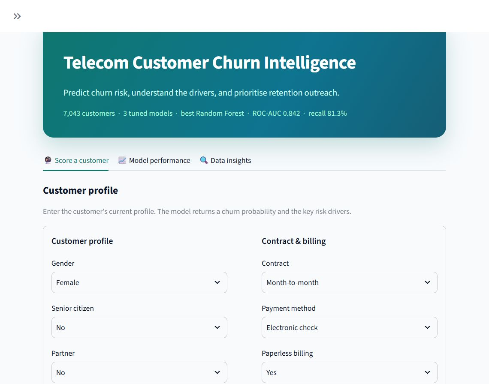
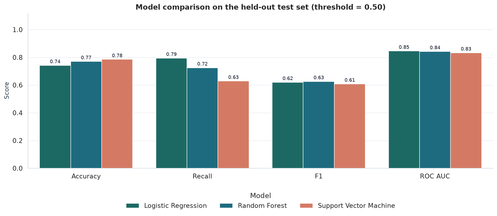
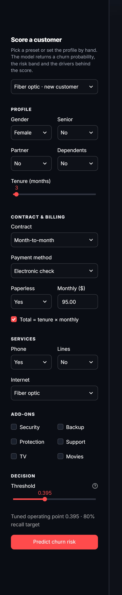
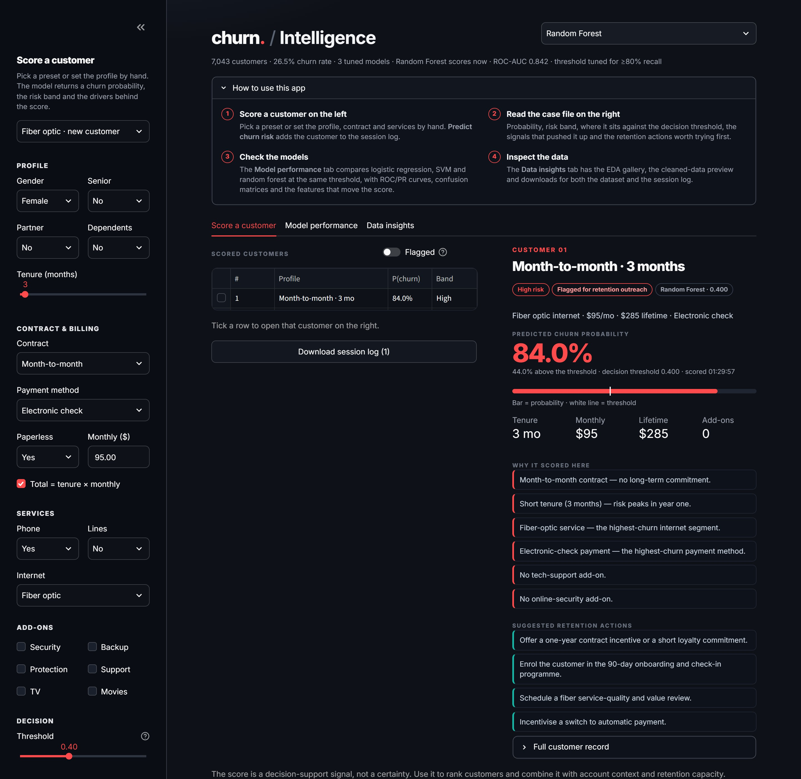
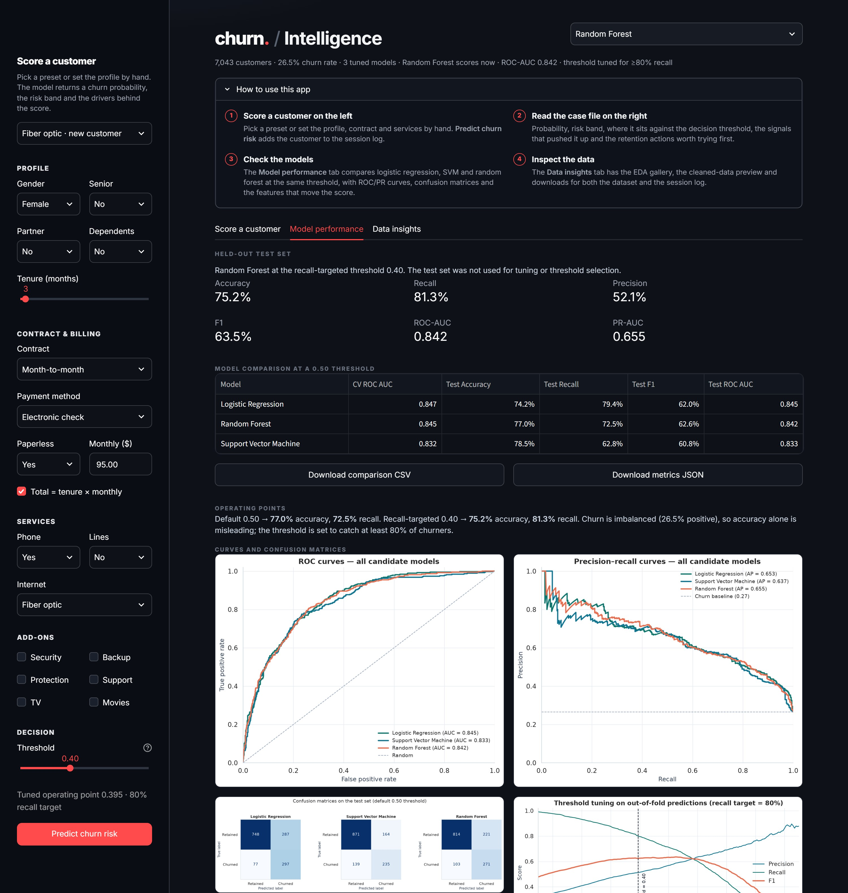
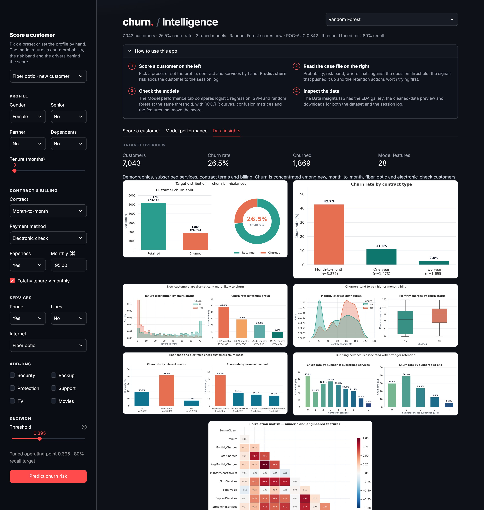
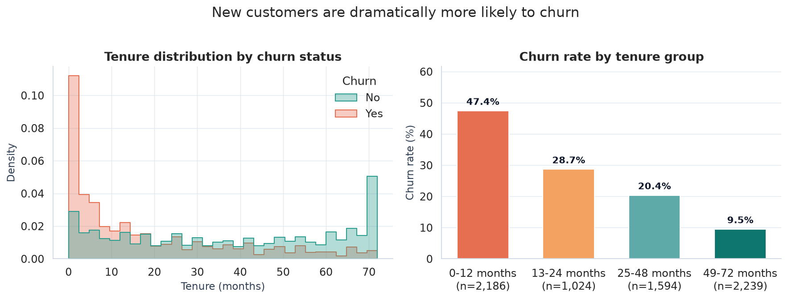
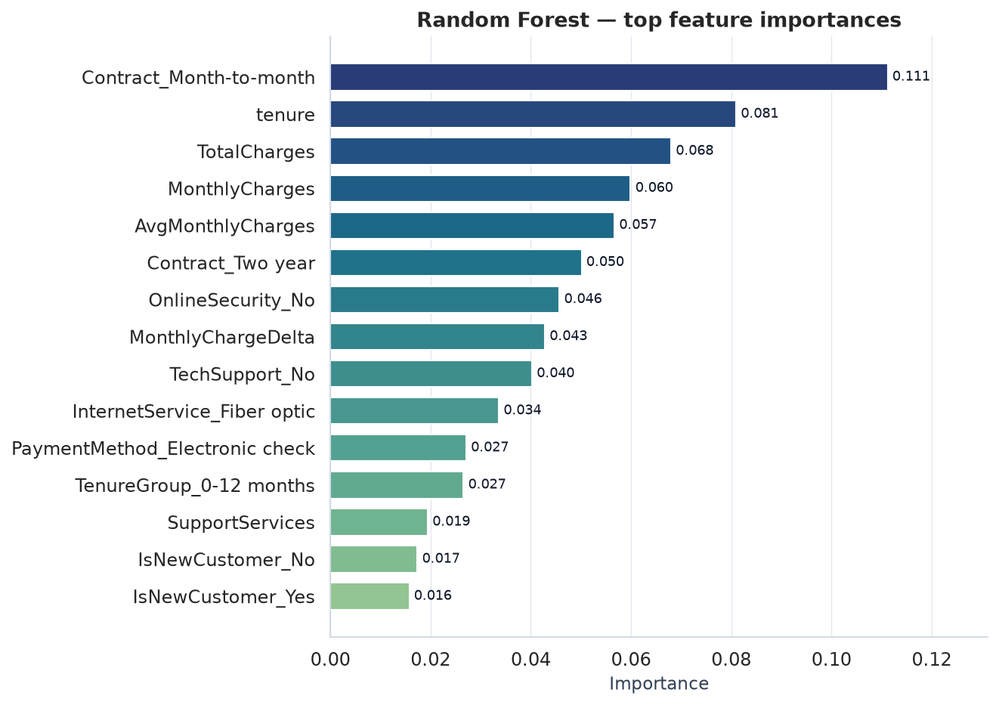

# 📞 Telecom Customer Churn Intelligence

**Predict which telecom customers are about to leave — and explain exactly why — with a
reproducible scikit-learn pipeline and an interactive Streamlit app.**


[](https://github.com/tausnix/telecom-churn-intelligence/actions/workflows/ci.yml)




**Jump to:** [Overview](#-overview) · [Results](#-results) · [Quickstart](#-quickstart) ·
[App tour](#-app-tour) · [How it works](#-how-it-works) · [Full report](reports/PROJECT_REPORT.md)

---

## 📌 Overview

Telecom operators lose revenue one customer at a time: acquisition costs are high, margins
are thin, and 26.5% of this dataset's customers churn. This project builds a **decision-support
system** that ranks customers by churn risk so a retention team can act *before* the customer
leaves.

It covers the full lifecycle of a real analytics deliverable:

| Stage | What was done |
|---|---|
| **Data cleaning** | 7,043 records, 21 raw columns, whitespace/type fixes, 11 blank `TotalCharges` imputed |
| **EDA** | 7 publication-quality charts and a written insight summary |
| **Feature engineering** | 9 target-free behavioural and billing features → 28 model inputs |
| **Modelling** | Logistic Regression, SVM and Random Forest, 5-fold CV grid search |
| **Selection** | One-standard-error rule with CV-F1 tie-break (no test-set peeking) |
| **Threshold tuning** | Operating point chosen on **out-of-fold** predictions to guarantee ≥80% recall |
| **Evaluation** | Accuracy, recall, precision, F1, ROC-AUC, PR-AUC, confusion matrix, 15 charts |
| **Delivery** | Interactive Streamlit app + reproducible one-command pipeline + written report |

### What makes this project different

- **No data leakage.** Scaling, encoding and threshold selection all happen inside the
  cross-validation folds; the test set is touched exactly once.
- **Recall-first, not accuracy-first.** A "never churn" model would be 73.5% accurate and
  completely useless. The operating threshold is tuned to catch churners.
- **Statistically grounded model choice.** Tied CV scores are broken with the
  one-standard-error rule instead of picking the prettiest number.
- **Explainable output.** Every score ships with the risk drivers and a recommended retention
  playbook, not just a probability.
- **Runs anywhere.** Trained model artefacts are committed, so the demo works seconds after
  `git clone`.

---

## 🏆 Results

**Final model: Random Forest** · operating threshold **0.395** · test set **n = 1,409**

| Metric | Score |
|---|---:|
| Accuracy | **75.2%** |
| Recall | **81.3%** |
| Precision | **52.1%** |
| F1 | **63.5%** |
| ROC-AUC | **0.842** |
| PR-AUC | **0.655** |

At the 0.395 threshold the model catches **304 of 374 churners** (81.3%) while flagging
280 false alarms — the right trade-off when the cost of losing a customer exceeds the cost
of a retention offer.

**Confusion matrix (test set):**

|  | Predicted retained | Predicted churned |
|---|---:|---:|
| **Actually retained** | 755 | 280 |
| **Actually churned** | 70 | **304** |

<details>
<summary><strong>Model comparison (test set @ 0.50 threshold)</strong></summary>

| Model | CV ROC-AUC | Accuracy | Precision | Recall | F1 | ROC-AUC | PR-AUC |
|---|---:|---:|---:|---:|---:|---:|---:|
| Logistic Regression | **0.847** | 74.2% | 50.9% | **79.4%** | 62.0% | **0.845** | 0.653 |
| **Random Forest** ✅ | 0.845 | **77.0%** | **55.1%** | 72.5% | **62.6%** | 0.842 | **0.655** |
| Support Vector Machine | 0.832 | **78.5%** | **58.9%** | 62.8% | 60.8% | 0.833 | 0.637 |

Logistic Regression and Random Forest are separated by **less than one CV standard error**
on ROC-AUC, so the one-standard-error rule treats them as tied and prefers Random Forest for
its higher CV F1 and stronger accuracy/recall balance at high-recall thresholds.

</details>



> **Why recall?** Only 26.5% of customers churn, so accuracy is dominated by the majority
> class. Recall, F1 and PR-AUC are the metrics that reflect business value. The full
> recall/precision/cost curve is exposed in [`reports/threshold_tuning.csv`](reports/threshold_tuning.csv).

---

## 🚀 Quickstart

```bash
# 1. Clone
git clone https://github.com/tausnix/telecom-churn-intelligence.git
cd telecom-churn-intelligence

# 2. Install dependencies (Python 3.12+; pinned in .python-version)
pip install -r requirements.txt

# 3. Launch the demo (trained models are already in the repo)
python -m streamlit run app.py
```

The app opens on **<http://localhost:8501>**. If the port is busy, Streamlit moves to
8502/8503 — read the "Local URL" printed in the terminal.

**Reproduce every artefact from scratch** (~2.5 minutes):

```bash
python run_pipeline.py
```

This re-cleans the data, regenerates the EDA figures, tunes all three models, evaluates on the
test set and rewrites `reports/`.

**Health check** (no browser needed):

```bash
python scripts/smoke_test.py
```

```
Best model: Random Forest
  Logistic Regression      p=0.9224  threshold=0.500  risk=High
  Random Forest            p=0.8824  threshold=0.395  risk=High
  Support Vector Machine   p=0.5956  threshold=0.500  risk=Moderate
All models loaded and scored successfully.
```

**Score a customer from the CLI:**

```bash
python -m src.predict --json examples/sample_customer.json
python -m src.predict --json examples/sample_customer.json --model "Logistic Regression"
```

---

### ☁️ Deploy your own live demo

[](https://share.streamlit.io/deploy?repository=tausnix/telecom-churn-intelligence&branch=main&mainModule=app.py)

The badge opens a **pre-filled** Streamlit Community Cloud deploy for this repository —
sign in with GitHub, confirm the branch (`main`) and file (`app.py`), and it builds in a few
minutes. No secrets are required, and the committed models mean nothing needs training.

Step-by-step guide, expected URL and troubleshooting:
[`docs/DEPLOYMENT.md`](docs/DEPLOYMENT.md).

---

## 🖥️ App tour

A single-page retention console in the same dark visual language as
[PromoFinder](https://github.com/tausnix/kuku-promo-finder): a control panel in the sidebar, a
brand header with live model stats, and a split work area — the session log on the left, the
selected customer's case file on the right.


### 1 · Score a customer

Pick a preset (fiber newcomer, DSL mid-tenure, loyal two-year, voice-only) or set the profile by
hand, move the decision threshold, then press **Predict churn risk**. Every score is appended to
the session log, and the case file shows the probability, band, position against the threshold,
the signals behind the score and the retention actions to try first.

| Control panel | Case file |
|---|---|
|  |  |

### 2 · Model performance

Metric cards, three-model comparison, operating points, ROC/PR curves, confusion matrices,
threshold-tuning curve and feature-importance charts.



### 3 · Data insights

Dataset overview, the full EDA gallery, cleaned-data preview and CSV download.



### Troubleshooting

- **Command asks for an email** — Streamlit prompts on its first run when not headless. Answer
  it once, or create `~/.streamlit/credentials.toml`:
  ```toml
  [general]
  email = ""
  ```
  Note: `.streamlit/config.toml` sets `headless = true` on purpose. On Streamlit Cloud there is no
  credentials file, so a non-headless server blocks on that prompt, never binds port 8501 and the
  deploy fails with **`Error running app.`**
- **Nothing opens in the browser** — copy the "Local URL" printed in the terminal into your
  browser. If the port is taken, Streamlit prints a different one.
- **`ModuleNotFoundError: No module named 'src'`** — run commands from the project root, not
  from inside `scripts/`.

---

## 🗂️ Project structure

```text
telecom-churn-intelligence/
├── app.py                     # Streamlit app (scoring · performance · insights)
├── run_pipeline.py            # One-command end-to-end pipeline
├── requirements.txt
├── LICENSE
├── README.md
│
├── data/
│   ├── raw/                   # IBM Telco Customer Churn CSV
│   └── processed/             # cleaned + engineered datasets
│
├── src/
│   ├── config.py              # paths, feature groups, constants
│   ├── preprocessing.py       # cleaning, feature engineering, model pipelines
│   ├── eda.py                 # 7 EDA figures + insight summary
│   ├── metrics.py             # metrics + threshold selection
│   ├── train.py               # tuning, one-SE selection, persistence
│   ├── evaluate.py            # comparison/ROC/PR/importance figures
│   ├── report.py              # generates PROJECT_REPORT.md
│   ├── predict.py             # inference helpers + CLI
│   └── utils.py               # shared I/O helpers
│
├── models/                    # trained pipelines + metadata (committed)
├── examples/
│   └── sample_customer.json   # ready-to-score customer record
├── scripts/
│   ├── download_data.py       # optional dataset re-download
│   └── smoke_test.py          # model health check
├── docs/
│   ├── DEPLOYMENT.md          # Streamlit Cloud deployment guide
│   └── screenshots/           # app screenshots used in this README
└── reports/
    ├── figures/               # 15 presentation-ready charts
    ├── PROJECT_REPORT.md      # full written report
    ├── eda_summary.md
    ├── metrics.json
    ├── model_comparison.csv
    └── threshold_tuning.csv
```

---

## 🔬 How it works

```text
data/raw CSV
   │  clean_data()          trim, dedupe, fix TotalCharges, validate ranges
   ▼
data/processed/clean CSV
   │  add_features()        9 target-free features
   ▼
28 model features
   │  ColumnTransformer     median impute + scale (numeric)
   │                        most-frequent impute + one-hot (categorical)
   ▼
Model Pipeline  ──►  5-fold GridSearchCV (ROC-AUC)
   │
   ├─► one-standard-error rule + CV-F1 tie-break  ──► best model
   │
   ├─► OOF probabilities  ──► threshold ≥ 80% recall (highest precision)
   │
   └─► untouched test set ──► final metrics, figures, report
```

**1 · Cleaning.** Whitespace is trimmed, duplicate rows removed, `TotalCharges` converted from
text to numeric and its 11 blank values imputed as `MonthlyCharges × tenure`, and every numeric
range is validated.

**2 · Feature engineering.** Nine deterministic, target-free features:

| Feature | Intuition |
|---|---|
| `TenureGroup` | Churn is concentrated in the first year |
| `IsNewCustomer` | Binary flag for tenure ≤ 12 months |
| `AvgMonthlyCharges` | `TotalCharges / max(tenure, 1)` — realised spend |
| `MonthlyChargeDelta` | Current vs lifetime average bill — price-shock signal |
| `NumServices` | Total subscribed services |
| `SupportServices` | Security/backup/protection/support bundle count |
| `StreamingServices` | Streaming TV/film bundle count |
| `FamilySize` | Partner + dependents |
| `HasInternet` | Internet subscriber flag |

**3 · Leak-free preprocessing.** Imputation, scaling and one-hot encoding live **inside** each
model's `Pipeline`, so they are fitted only on training folds.

**4 · Imbalance handling.** Balanced class weights for Logistic Regression and SVM,
`balanced_subsample` for Random Forest.

**5 · Selection.** Hyper-parameters are tuned with 5-fold `GridSearchCV` on ROC-AUC. The
one-standard-error rule picks the simplest model within one SE of the best score; ties are
broken on CV F1.

**6 · Thresholding.** Out-of-fold probabilities choose the most precise threshold that still
catches ≥80% of churners. The test set is never used for tuning or threshold selection.

**7 · Reporting.** Figures, metrics JSON, CSVs and a generated markdown report.

### Methodology choices

- **No leakage** — feature engineering is deterministic; the threshold sees OOF predictions only.
- **Reproducibility** — `random_state=42`, stratified 80/20 split (5,634 / 1,409), 5-fold CV.
- **Interpretability** — Random Forest importances and standardised Logistic Regression
  coefficients agree on contract type, tenure, charges, fiber-optic service, payment method and
  support add-ons.
- **Honest metrics** — accuracy is always reported next to recall, precision, F1, ROC-AUC and
  PR-AUC, alongside the 73.5% majority-class baseline.

---

## 📊 Key EDA findings

| Segment | Churn rate |
|---|---:|
| Month-to-month contract | **42.7%** |
| Fiber-optic internet | **41.9%** |
| Electronic-check payment | **45.3%** |
| Tenure 0–12 months | **47.4%** |
| No internet service | 7.4% |
| Two-year contract | **2.8%** |

- Churners have a **median tenure of 10 months** vs **38 months** for retained customers.
- Churners pay **$74.44/month** on average vs **$61.27** for retained customers.
- More services and support add-ons correlate with **lower** churn — bundling raises switching
  costs.
- Strongest numeric correlates of churn: `MonthlyCharges` (+0.19) and `tenure` (−0.35).

| Tenure analysis | Feature importance |
|---|---|
|  |  |

---

## 🔁 Reproducibility

| Item | Value |
|---|---|
| Random seed | `42` |
| Split | Stratified 80/20 → 5,634 train / 1,409 test |
| Cross-validation | 5-fold, tuned on ROC-AUC |
| Selection rule | One-standard-error, CV-F1 tie-break |
| Threshold rule | Highest precision at recall ≥ 0.80 (OOF only) |
| Regenerate everything | `python run_pipeline.py` |

All metrics in this README are generated by the pipeline into
[`reports/metrics.json`](reports/metrics.json) and
[`reports/model_comparison.csv`](reports/model_comparison.csv) — nothing is hard-coded.

**Continuous integration.** Every push runs GitHub Actions: a smoke test that loads all three
trained models and scores the sample customer on Python 3.12, plus a full
`python run_pipeline.py` regeneration on a clean runner.

---

## ⚠️ Limitations & roadmap

- Single historical snapshot; a production system must be retrained and monitored for drift.
- No usage, support-ticket, competitor-pricing or network-quality signals.
- Precision at the 80%-recall point is ~52%, so outreach must be sized to team capacity.
- A cost-sensitive threshold (retention-offer cost vs customer lifetime value) is the natural
  next step.
- Worth trying: gradient boosting (XGBoost/LightGBM), SHAP per-customer explanations, and
  uplift modelling to target *persuadable* customers rather than the merely high-risk.

---

## 📚 Dataset & credits

**IBM Telco Customer Churn** — a public benchmark dataset of 7,043 customers, 21 columns,
used here for educational and portfolio purposes.

- Source: [IBM/telco-customer-churn-on-icp4d](https://github.com/IBM/telco-customer-churn-on-icp4d)
- The raw CSV is included in `data/raw/`; `python scripts/download_data.py` re-downloads it.

---

## 📄 License

Released under the [MIT License](LICENSE).

## 👤 Author

**tausnix** — [github.com/tausnix](https://github.com/tausnix)

If this project was useful or interesting, a ⭐ on the repository is appreciated.
