# Telecom Customer Churn Prediction — Project Report

## Executive summary

This project predicts which telecom customers are about to churn so the retention
team can intervene before revenue is lost. Using the IBM Telco Customer Churn
dataset (**7,043 customers**, **28 model features**
— 19 raw plus 9 engineered),
three classifiers were tuned and compared with a leak-free scikit-learn
pipeline.

**Random Forest** was selected with a one-standard-error rule on 5-fold
cross-validated ROC-AUC (statistically tied models were compared on CV F1).
At a recall-targeted decision threshold of **0.40**, chosen on
out-of-fold predictions to catch at least 80% of churners, it achieves:

| Metric | Score |
|---|---:|
| Accuracy | 75.2% |
| Recall (churners caught) | 81.3% |
| Precision | 52.1% |
| F1 score | 63.5% |
| ROC-AUC | 0.842 |
| PR-AUC | 0.655 |

On the held-out test set this means the retention team can flag
**584 of 1,409 customers**, catching **304 of the
374 actual churners** (81.3%) while
**47.9%** of flagged customers would not have churned.
Adjusting the threshold trades recall against outreach cost; the saved
`reports/threshold_tuning.csv` supports that business decision.

> **Why not accuracy alone?** Only 26.5% of customers
> churn. A model that predicts "no churn" for everyone would score
> 73.5% accuracy while catching zero churners.
> Recall, F1 and PR-AUC are therefore the primary metrics.

## 1. Dataset

- **Source:** IBM Telco Customer Churn (public benchmark dataset).
- **Rows:** 7,043 customers.
- **Raw columns:** 21 (demographics, services, contract and billing).
- **Target:** `Churn` — 1,869 churned
  (26.5%), 5,174 retained.
- **Class imbalance:** approximately 2.8:1
  retained-to-churned.

## 2. Data cleaning and quality

| Check | Result |
|---|---|
| Raw rows | 7,043 |
| Duplicate rows removed | 0 |
| Missing `TotalCharges` values (blank strings) | 11 |
| Invalid tenure values | 0 |
| Negative charge rows | 0 |
| Missing values after cleaning | 0 |

`TotalCharges` is stored as text in the raw file and is blank for brand-new
customers (`tenure = 0`). It is converted to numeric and blanks are imputed as
`MonthlyCharges × tenure`, which is exact for a new customer and consistent
with the billing definition. Exact duplicates are dropped, whitespace is
trimmed, and the target is mapped to 0/1. Genuine high-value outliers are kept
because they carry churn signal and tree models are robust to them.

## 3. Feature engineering

| Feature | Definition | Hypothesis |
|---|---|---|
| `TenureGroup` | Tenure bucketed into 0–12, 13–24, 25–48, 49–72 months | Risk is concentrated in the first year |
| `IsNewCustomer` | Tenure ≤ 6 months | Early-lifecycle churn |
| `AvgMonthlyCharges` | `TotalCharges / max(tenure, 1)` | Lifetime spend pattern |
| `MonthlyChargeDelta` | `MonthlyCharges − AvgMonthlyCharges` | Recent price increases / discounts ending |
| `NumServices` | Count of subscribed services (0–8) | Bundling increases switching costs |
| `SupportServices` | Count of security/backup/protection/support add-ons (0–4) | Support reduces friction |
| `StreamingServices` | Count of TV/movie streaming add-ons (0–2) | Entertainment engagement |
| `FamilySize` | Partner + dependents (0–2) | Household stability |
| `HasInternet` | Whether the customer has internet service | Internet customers behave differently |

All engineered features are deterministic and target-free, so they are created
before the train/test split without leakage.

## 4. Exploratory data analysis

**Churn is concentrated in three segments:**

- **Month-to-month** has the highest churn (42.7%, n=3,875), compared with **Two year** at 2.8%.
- **Fiber optic** has the highest churn (41.9%, n=3,096), compared with **No** at 7.4%.
- **Electronic check** has the highest churn (45.3%, n=2,365), compared with **Credit card (automatic)** at 15.2%.

**Tenure and billing:**

- Churners have a median tenure of **10 months**
  versus **38 months** for retained customers.
- Churners pay **$74.44/month** on average versus
  **$61.27** for retained customers.
- Customers with more services and more support add-ons churn less, consistent
  with a bundling / switching-cost effect.

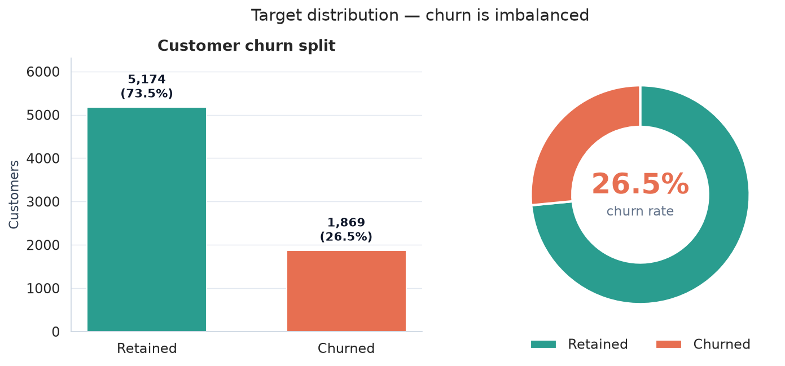
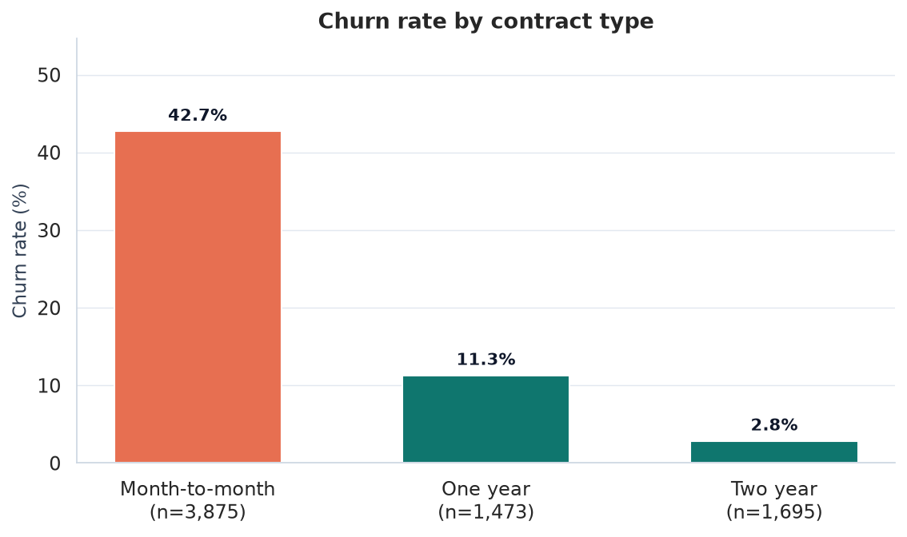
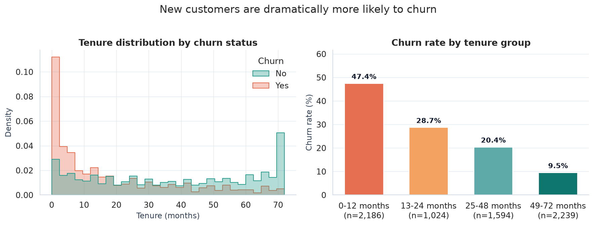
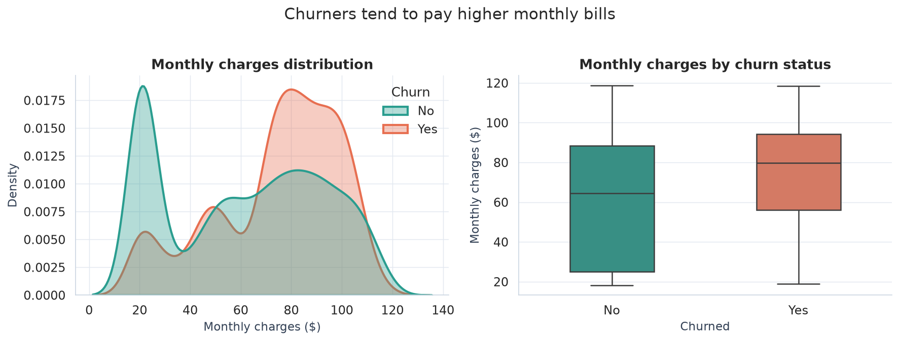
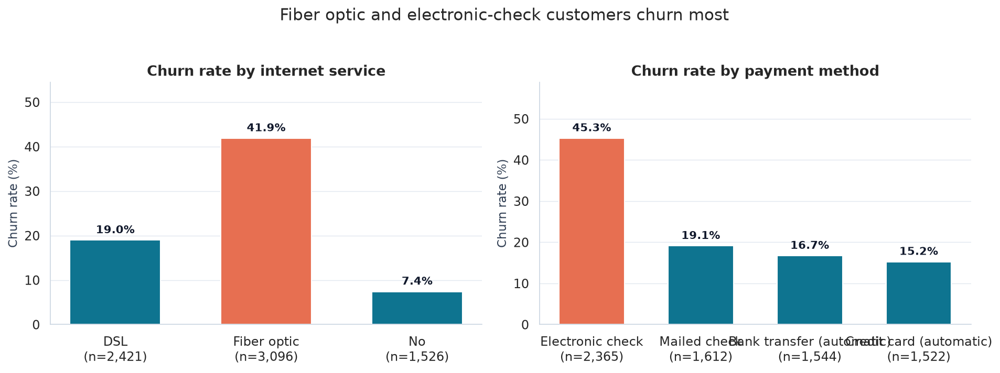
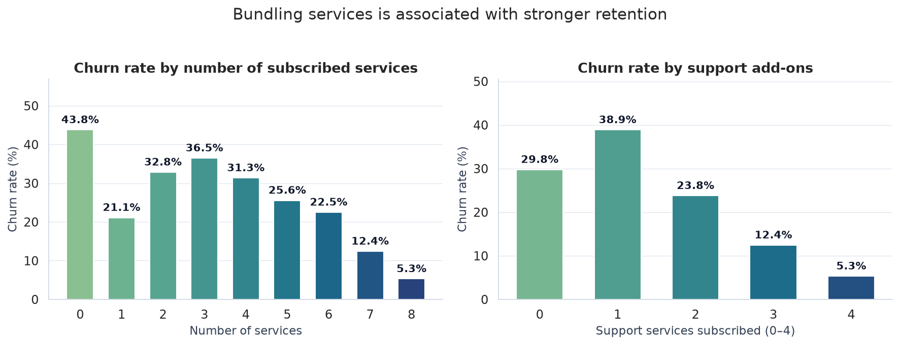
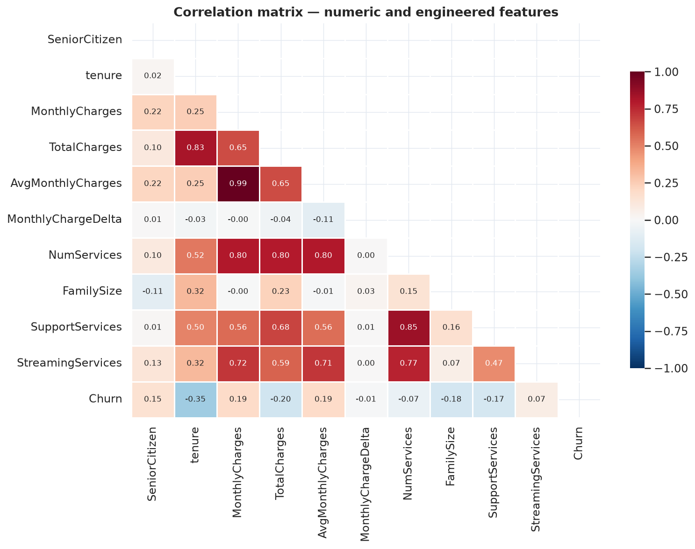

The full numeric breakdown is in `reports/eda_summary.md`.

## 5. Modelling approach

1. **Split:** stratified 80/20 train/test split (`random_state=42`) preserves the
   churn ratio. The test set is touched only once, at final evaluation.
2. **Preprocessing:** median imputation + standard scaling for numeric features;
   most-frequent imputation + one-hot encoding for categorical features. All
   preprocessing lives inside the model pipeline to prevent leakage.
3. **Class imbalance:** balanced class weights for Logistic Regression and SVM,
   and `balanced_subsample` for Random Forest.
4. **Tuning:** 5-fold `GridSearchCV`, refitting on ROC-AUC, which is independent
   of the decision threshold.
5. **Model selection:** a one-standard-error rule. Models within one CV standard
   error of the best ROC-AUC are treated as tied and compared on CV F1, which
   better reflects the imbalanced precision/recall objective.
6. **Threshold selection:** the winning model's out-of-fold probabilities are
   used to find the most precise threshold that still catches at least 80% of
   churners in cross-validation. The test set is never used to choose the
   threshold.
7. **Comparison:** accuracy, precision, recall, F1, ROC-AUC and PR-AUC are
   reported for every model at the default 0.50 threshold.

## 6. Results

| Model | CV ROC AUC | Test Accuracy | Test Precision | Test Recall | Test F1 | Test ROC AUC | Test PR AUC | Best Params |
|---|---|---|---|---|---|---|---|---|
| Logistic Regression | 0.847 | 0.742 | 0.509 | 0.794 | 0.620 | 0.845 | 0.653 | {'C': 0.1} |
| Random Forest | 0.845 | 0.770 | 0.551 | 0.725 | 0.626 | 0.842 | 0.655 | {'max_depth': 12, 'min_samples_leaf': 4} |
| Support Vector Machine | 0.832 | 0.785 | 0.589 | 0.628 | 0.608 | 0.833 | 0.637 | {'C': 0.5, 'gamma': 'scale'} |

`Best Params` are the winning hyper-parameters from cross-validation.

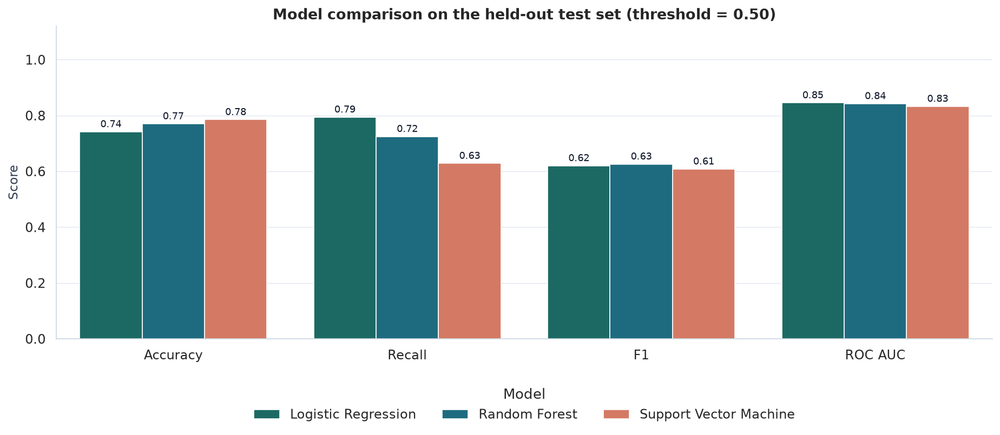
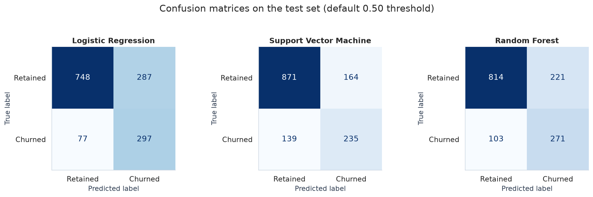
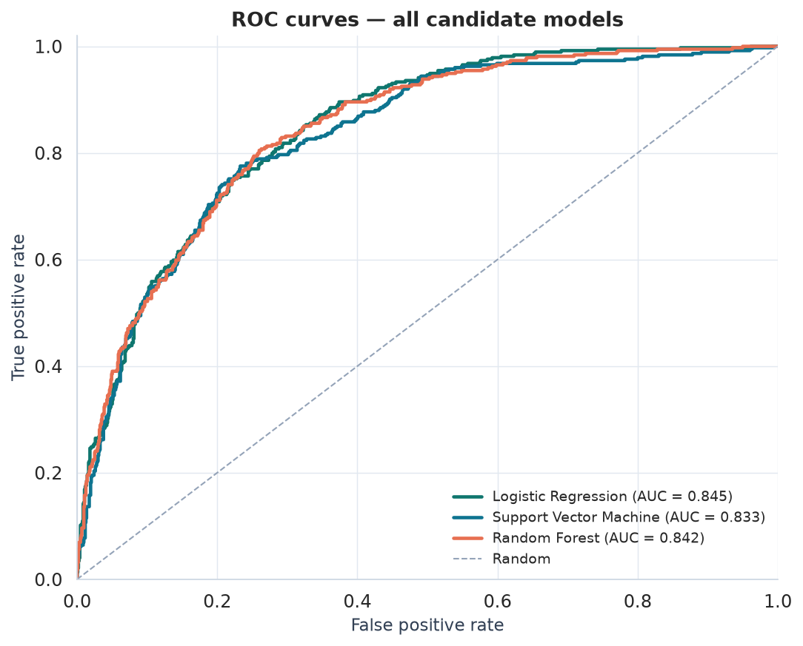
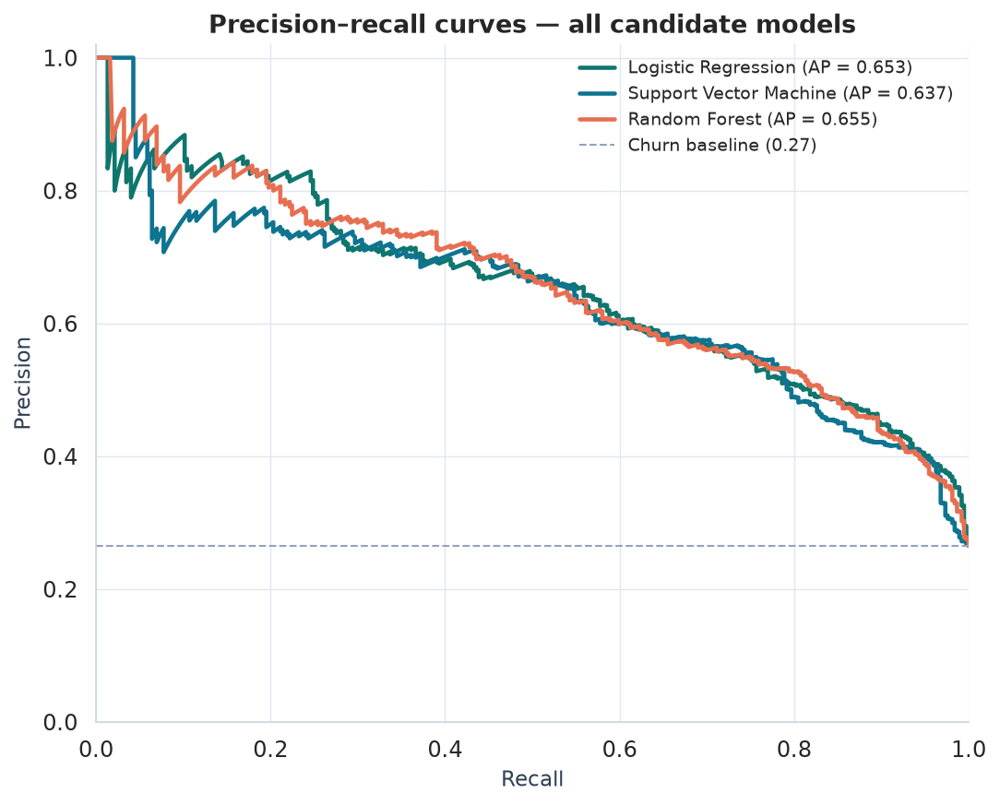

### Winning model: Random Forest

| Operating point | Accuracy | Precision | Recall | F1 |
|---|---:|---:|---:|---:|
| Default threshold 0.50 | 77.0% | 55.1% | 72.5% | 62.6% |
| Recall-targeted threshold 0.40 | 75.2% | 52.1% | 81.3% | 63.5% |

Confusion matrix at the tuned threshold:

| | Predicted retained | Predicted churned |
|---|---:|---:|
| **Actual retained** | 755 (TN) | 280 (FP) |
| **Actual churned** | 70 (FN) | 304 (TP) |

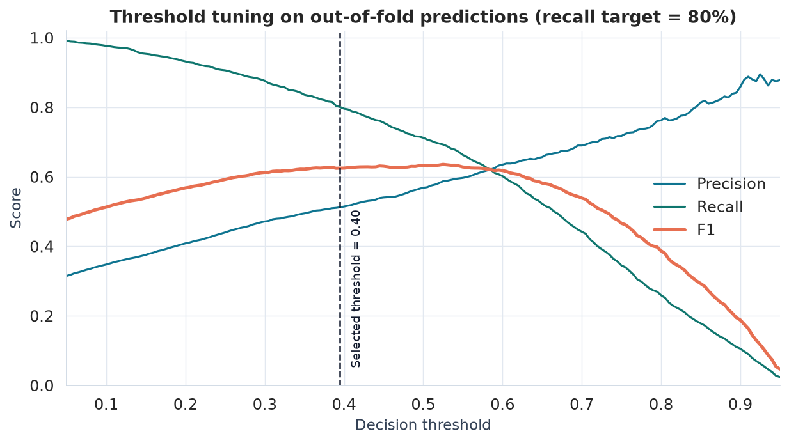
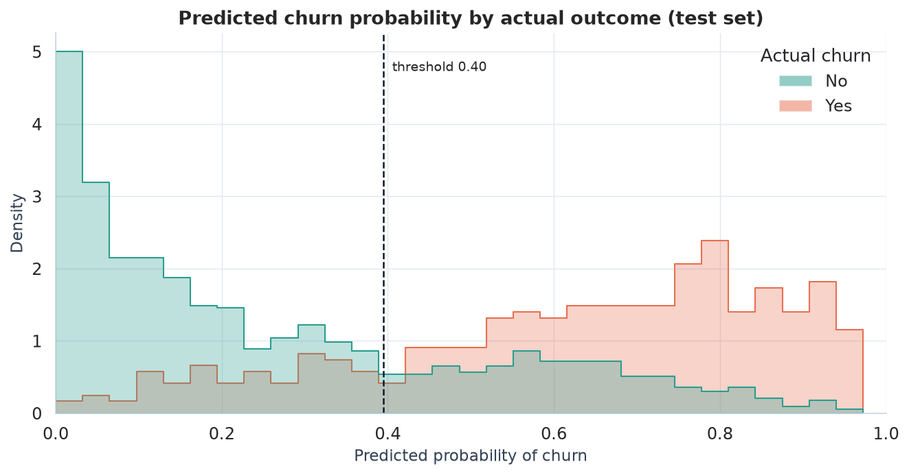

## 7. What drives churn?

Random Forest importance and standardised Logistic Regression coefficients
agree on the main signals:

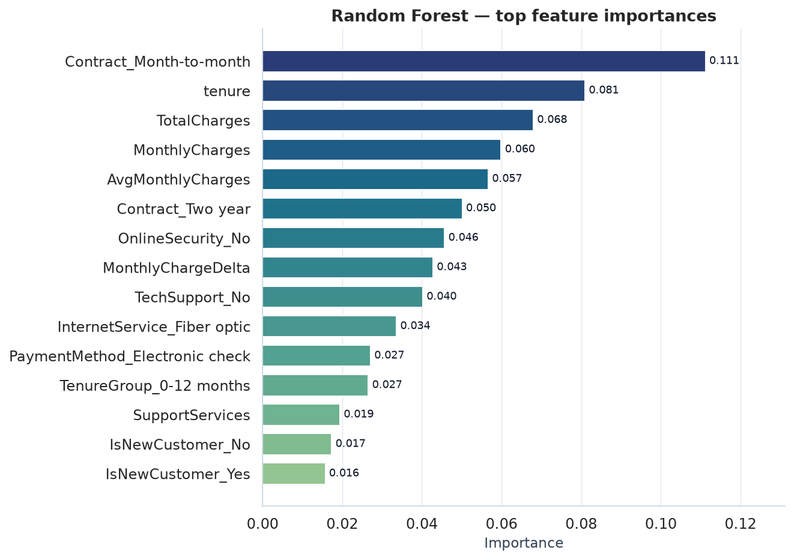
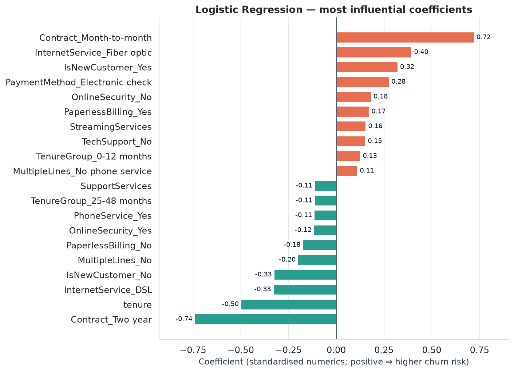

The dominant risk factors are short tenure, month-to-month contracts, fiber-optic
internet, electronic-check payment, high monthly charges and a lack of support
add-ons. Full rankings are saved to `reports/feature_importance.csv` and
`reports/logistic_coefficients.csv`.

## 8. Business recommendations

1. **Prioritise the first year.** Trigger an onboarding and check-in programme at
   months 1, 3 and 6 for new customers; this is where churn risk peaks.
2. **Convert month-to-month customers.** Offer targeted discounts or added
   services in exchange for a one-year contract, focusing on high-probability
   churners first.
3. **Use the model as a triage queue.** At threshold 0.40, the model
   catches 81.3% of churners. Rank the queue by predicted
   probability and size it to the retention team's capacity.
4. **Bundle support and security add-ons.** These services correlate with lower
   churn; include them in retention offers rather than discounting price alone.
5. **Fix the fiber-optic value gap.** Investigate service quality, pricing and
   expectation-setting for fiber customers, who churn more than DSL customers.
6. **Incentivise automatic payments.** Electronic-check customers churn most;
   small incentives for auto-pay could reduce friction and churn.

## 9. Limitations and next steps

- The dataset is a single historical snapshot; churn drivers may drift over time.
  Retrain on a rolling schedule and monitor recall, PR-AUC and calibration.
- Accuracy is bounded by the available features; support tickets, usage,
  competitor pricing and network quality would add predictive power.
- A false positive costs a retention offer, while a false negative costs the
  customer's lifetime value. Formalise this in a cost-sensitive threshold
  instead of a single recall target.
- Probability calibration (isotonic/Platt) should be validated before using
  scores directly in financial forecasts.
- Explore gradient boosting (XGBoost/LightGBM) and SHAP explanations for
  per-customer retention actions.

## 10. Reproducing the project

```bash
pip install -r requirements.txt
python run_pipeline.py         # cleaning → EDA → training → evaluation → reports
streamlit run app.py           # interactive demo
```

Outputs: `reports/figures/`, `reports/metrics.json`,
`reports/model_comparison.csv`, `models/churn_model.joblib` and
`models/model_metadata.json`.
